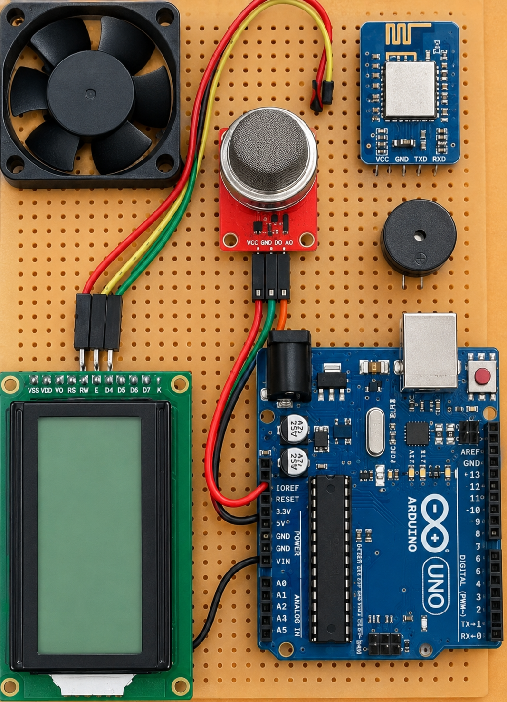
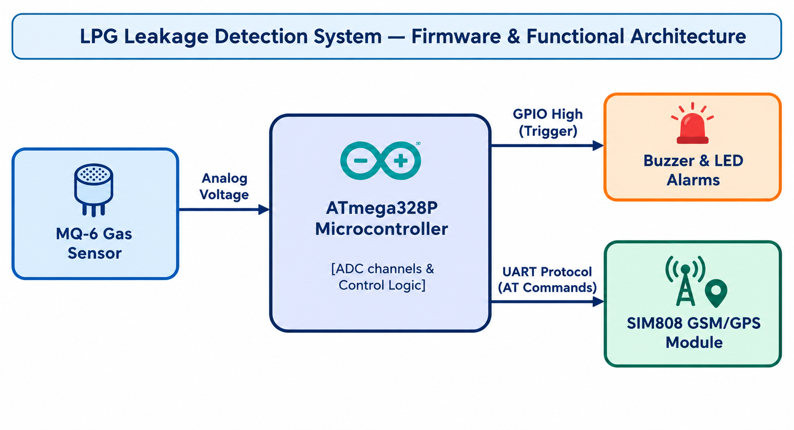

# LPG Leakage Detection System with Real-Time Cellular Alerts

An entry-level embedded firmware safety prototype built on the **ATmega328P microcontroller** using bare-metal **Embedded C**. The system continuously monitors ambient gas concentration levels, triggers local alarms upon breach, and transmits automated GPS location coordinates via cellular SMS text messages.

## 🚀 Key Features
* **Analog Data Conversion:** Configured internal ADC channels to sample continuous voltage streams from an MQ-6 sensor.
* **Smart Threshold Triggering:** Implemented real-time boundary condition logic to activate local buzzer hardware when gas levels cross safety limits.
* **Serial Protocols Integration:** Interfaced SIM808 GSM/GPS hardware module via dedicated **UART** serial communication lines (TX/RX).
* **Hardware-Level Debugging:** Handled electrical line debugging, noise isolation, and voltage checks using oscilloscopes and digital multimeters.

## 📸 Hardware Setup & Prototyping
  
*Figure 1: Physical hardware connections layout indicating ATmega328P microcontroller core, MQ gas sensor, status LCD, exhaust fan, and wireless modules.*

## 📊 System Architecture Block Diagram
  
*Figure 2: Functional block layout showcasing internal ADC sampling routines and peripheral UART protocol interfaces.*

## 🛠️ How It Works (System Architecture)
1. **Data Acquisition:** The MQ-6 sensor outputs a continuous analog voltage proportional to the LPG concentration in the air.
2. **ADC Processing:** The ATmega328P's internal Analog-to-Digital Converter samples this signal and updates an internal registry variable.
3. **Control Logic:** If the digital value exceeds the predefined safety limit:
   * A GPIO pin goes `HIGH` to toggle an active buzzer/LED alarm circuit.
   * A software loop sequence triggers a command structure sent over **UART Tx**.
4. **Wireless Alerting:** The GSM module parses the AT commands from the microcontroller, fetches the active GPS latitude/longitude strings, and broadcasts an emergency alert text message to a designated mobile number.

## 📂 Repository Structure
* `main.c` : Contains the bare-metal firmware source file written in Embedded C.
* `hardware_setup.png` : High-resolution image of the deployed hardware prototype.
* `architecture_diagram.png` : System architectural block schematic.

## 🔧 Tools & Tech Stack
* **Language:** Embedded C / C++
* **Hardware Stack:** ATmega328P Microcontroller, MQ-6 Gas Sensor, SIM808 GSM/GPS, Active Buzzer, 16x2 LCD
* **IDE & Toolchains:** Arduino IDE / Keil uVision / Microchip Studio

