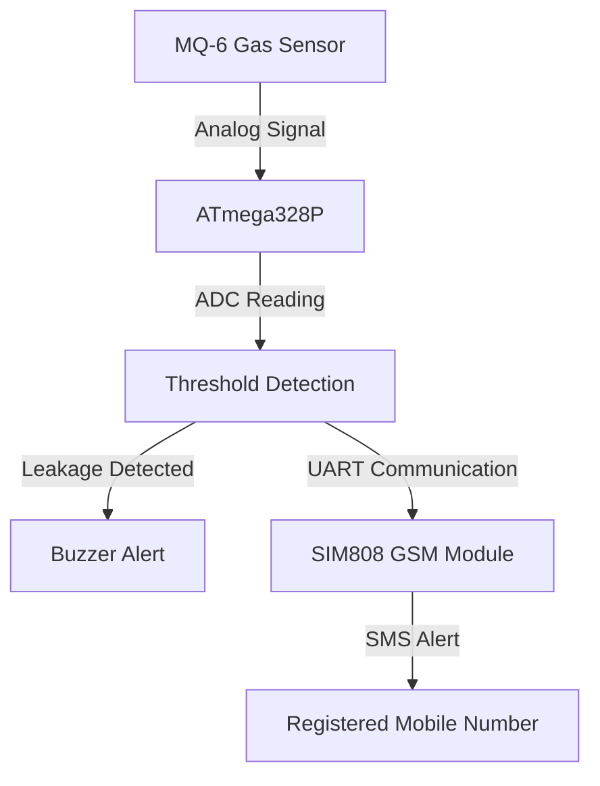

# LPG Leakage Detection and SMS Alert System

An embedded systems project built using **Embedded C and the ATmega328P microcontroller** to detect LPG gas leakage and trigger an audible warning and SMS alert using a SIM808 GSM module.

## Project Overview

LPG leakage can create serious fire and safety risks. This project uses an MQ-6 gas sensor to monitor gas concentration. When the sensor reading crosses a configured threshold, the ATmega328P activates a buzzer and sends an emergency SMS through the SIM808 GSM module.

The firmware is developed using bare-metal Embedded C and AVR register-level peripheral configuration.

## Key Features

- LPG gas detection using the MQ-6 sensor.
- Analog sensor reading through the ATmega328P ADC.
- Configurable gas detection threshold.
- Audible warning through a buzzer.
- UART-based communication with the SIM808 GSM module.
- SMS alert when the gas reading exceeds the threshold.
- Alert flag to prevent repeated SMS transmission while the reading remains above the threshold.

## System Architecture



## Hardware Components

| Component | Purpose |
|---|---|
| ATmega328P | Main microcontroller |
| MQ-6 Gas Sensor | LPG detection |
| SIM808 GSM Module | SMS communication |
| Buzzer | Audible warning |
| Power Supply | Powers the circuit |
| Connecting Wires | Hardware interconnections |

## Pin Configuration

| ATmega328P Pin | Function |
|---|---|
| PC0 / ADC0 | MQ-6 analog output |
| PB5 | Buzzer control |
| PD0 / RXD | UART receive from SIM808 |
| PD1 / TXD | UART transmit to SIM808 |

**Communication configuration:**
- Microcontroller clock: 16 MHz
- UART baud rate: 9600 bps
- ADC input channel: ADC0

## Software and Development Tools

- Programming Language: Embedded C
- Microcontroller: ATmega328P
- IDE: Microchip Studio 7
- Compiler: AVR-GCC
- Communication Protocol: UART
- Peripheral Configuration: AVR register-level programming

## Working Principle

1. The MQ-6 sensor monitors the surrounding air for LPG.
2. Its analog output is read using the ATmega328P ADC.
3. The firmware compares the ADC reading against the configured gas threshold.
4. When the reading exceeds the threshold, the buzzer is activated.
5. The microcontroller communicates with the SIM808 module using UART AT commands.
6. An SMS alert is sent to the configured mobile number.
7. The alert flag prevents repeated SMS transmission until the sensor reading falls below the threshold.

## Project Structure

```text
LPG-Leakage-Detection-System/
│
├── main.c
├── README.md
└── images/
    ├── architecture.png
    └── hardware_setup.jpg
```

*The images folder can be added when the architecture and hardware setup images are uploaded.*

## Important Implementation Notes

- The gas threshold is a configurable ADC value and must be calibrated through sensor testing. It is not a certified safety limit.
- The current firmware uses placeholder SMS destination details for public-source safety.
- The current SMS message does not contain live GPS coordinates. GPS data acquisition and parsing are not implemented.
- The SIM808 communication routine uses fixed delays and does not verify modem responses. Reliable operation requires hardware testing and modem-response handling.
- Actual gas detection performance depends on sensor calibration, warm-up, power supply, and hardware integration.

## Future Improvements

- Implement live GPS data acquisition and parsing.
- Add UART response checking and error handling for the GSM module.
- Introduce threshold hysteresis to improve alert stability.
- Add sensor calibration and improved gas-level monitoring.
- Perform complete hardware validation and testing.

## Build Status

The firmware has been successfully compiled in Microchip Studio for the ATmega328P, and a HEX output file has been generated.

**Note:** Successful compilation does not yet establish physical hardware functionality; hardware validation is still required.

## Author

**Balija Neela Sri**

Embedded Systems | Firmware Development | Embedded C

